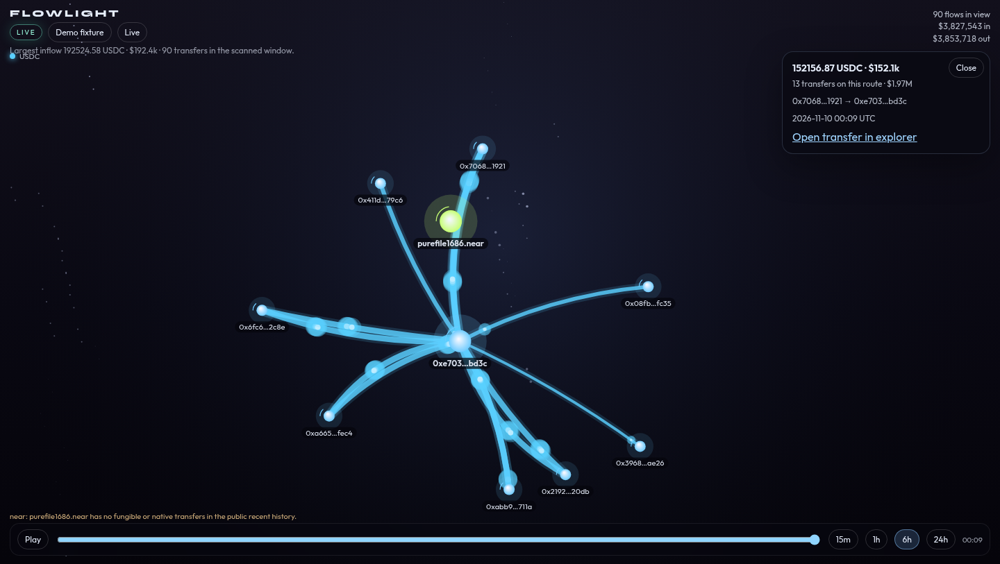
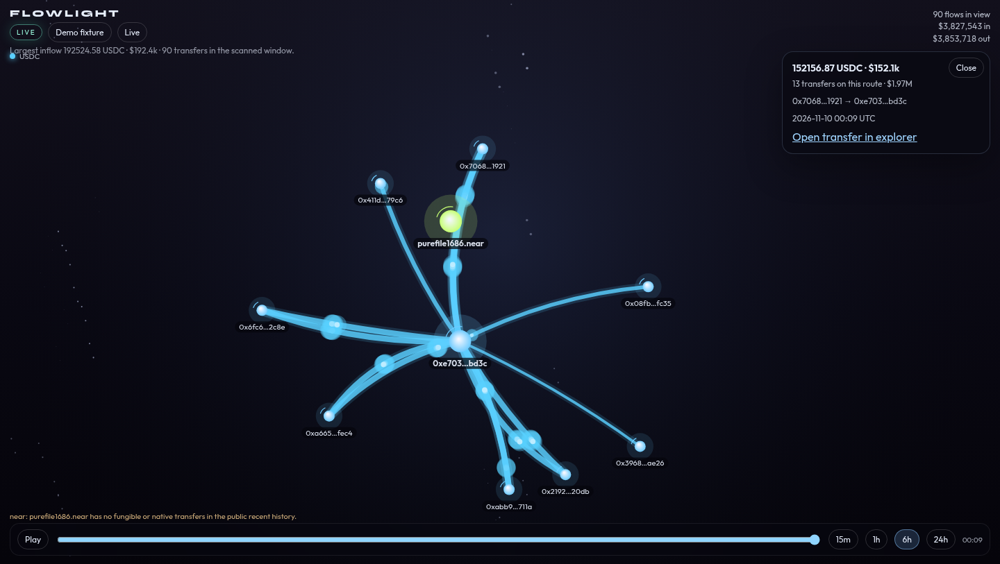
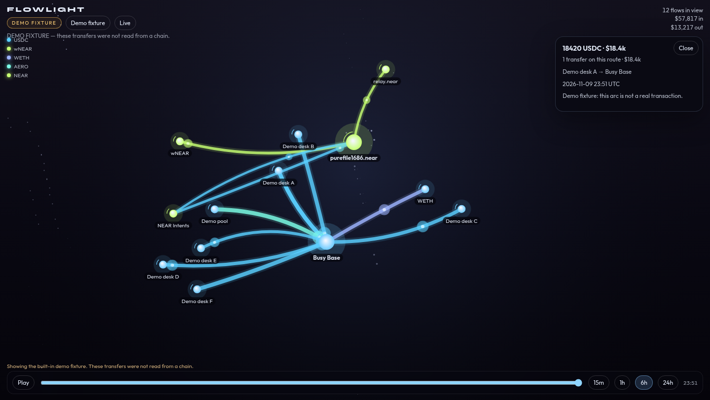

# Flowlight

Flowlight watches public wallets and draws the money moving through them. Hermes can say what the largest inflow was. A desktop pane, a dashboard tab, and a loopback page all draw the same picture: glowing arcs between addresses, colored by token, thick when the amount is large, with particles running in the direction of the transfer.

It is read-only. It does not sign, it does not send, and it does not ask for a seed phrase or a private key.



The shot above is live data from 10 Nov 2026: `purefile1686.near` plus a busy Base address. The green node is the NEAR account. It had no transfers in the public recent history, so it stays lit and still. The cyan rivers are USDC on Base. The raw Hermes session is [`docs/demo/hermes-session.txt`](docs/demo/hermes-session.txt). A short capture of the animation is [`docs/demo/flowlight.mp4`](docs/demo/flowlight.mp4) ([GIF](docs/demo/flowlight.gif)).





## Install

After the catalog entry is merged:

```bash
hermes plugins install flowlight
```

Before that, from this repository (it has to be public for other people to clone it):

```bash
hermes plugins install https://github.com/ayinmodeolarewaju-bot/hermes-flowlight --enable
```

A local checkout:

```bash
ln -sfn "$PWD" ~/.hermes/plugins/flowlight
hermes plugins enable flowlight
```

No API key is required.

## What you can ask Hermes

- "Watch purefile1686.near and 0xe7030be388b8e247abe0c9fa876673e83fbcbd3c on Base."
- "What was the largest inflow?"
- "List the transfers."
- "Stop watching the Base address."

Slash command:

```text
/flowlight watch purefile1686.near and 0xe7030be388b8e247abe0c9fa876673e83fbcbd3c on Base
/flowlight summary
/flowlight flows
/flowlight list
/flowlight unwatch 0xe7030be388b8e247abe0c9fa876673e83fbcbd3c on Base
/flowlight demo
```

CLI, the same code path:

```bash
hermes flowlight watch purefile1686.near and 0xe7030be388b8e247abe0c9fa876673e83fbcbd3c on Base
hermes flowlight summary
hermes flowlight flows
hermes flowlight list
hermes flowlight demo
hermes flowlight serve
```

`hermes flowlight serve` opens the picture at `http://127.0.0.1:8787/` on loopback only. Add `--demo` to start on the labeled fixture. The page can switch between **Live** and **Demo fixture** without restarting.

## Tools

| Tool | What it does |
| --- | --- |
| `flowlight_watch` | Remember one or more public addresses and read their recent transfers. |
| `flowlight_unwatch` | Drop an address from the watch list. |
| `flowlight_flows` | Recent transfers with amount, token, USD when a public price exists, direction, and an explorer link. |
| `flowlight_summary` | Largest inflow, largest outflow, priced totals, and the window that was actually scanned. |
| `flowlight_list` | Addresses currently watched. |

EVM addresses need a chain: `base`, `ethereum`, `arbitrum`, or `optimism`. A NEAR account (`name.near`) does not. Solana is accepted when you name that chain. It is best-effort against the public RPC.

The summary says when the scanned window is shorter than the requested lookback. Busy addresses hit a cap. Flowlight keeps the largest recent transfers instead of pretending it read every log in 24 hours.

## The picture

`desktop/plugin.js` adds a Flowlight pane, a `/flowlight` page, a sidebar row, a command-palette entry, and a status chip. `dashboard/` adds a tab and the API the pane calls. The loopback page uses the same `frontend/engine.js`. Arcs are token-colored. Watched accounts are the brighter nodes. Click a node or an arc for the amount, the route, and an explorer link. The scrubber and Play button replay the window. Drag to pan, scroll to zoom.

The amber **DEMO FIXTURE** badge means the arcs were not read from a chain. Live mode never substitutes the fixture when a read fails. A failed source shows a warning and whatever the other sources returned.

## Data sources

All of these are public. None of them is a paid key.

| Chain | First try | Fallback |
| --- | --- | --- |
| NEAR | [NearBlocks](https://api.nearblocks.io) account transfers | The warning says the history was unavailable. |
| Ethereum, Base, Arbitrum, Optimism | Blockscout `api/v2` token transfers and native transactions | Public JSON-RPC `eth_getLogs` for major tokens (USDC, USDT, WETH, and a few chain staples such as AERO on Base). |
| Solana | Public `getSignaturesForAddress` / `getTransaction` | Skipped with a warning when the RPC refuses. |
| USD | [CoinGecko](https://api.coingecko.com) simple price, cached | Stablecoins stay at $1. Unpriced tokens still draw. They just don't get a dollar figure. |

Reads are cached for a short time, paced per host, and retried with backoff on 429. A host that answers 403 is left alone for a few minutes. Base Blockscout often answers a challenge from this kind of network. The RPC fallback is what the live screenshots used.

## Safety

- No seed phrases, private keys, or signing keys. A phrase that looks like one is refused.
- No transaction is built, signed, or broadcast.
- Watches and the short flow cache live under the profile plugin-data directory (`FLOWLIGHT_DATA_DIR` overrides it). They are not written into the install tree.
- The loopback server binds to 127.0.0.1 only.
- No telemetry.

## Tests

```bash
python -m pip install "pytest==8.3.5"
python -m pytest
python scripts/bundle_frontend.py --check
```

Catalog check, against Hermes Agent v0.23.0:

```bash
hermes plugins validate . --install-deps
hermes plugins doctor . --ci
```
